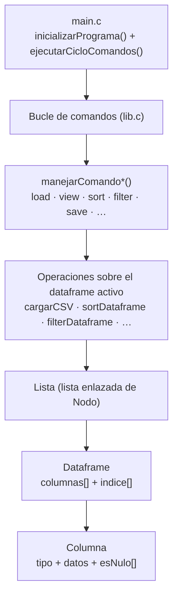

# dataframe-C

[](https://github.com/jamalmn/dataframe-C/actions/workflows/ci.yml)
[](LICENSE)


Mini "dataframe" al estilo pandas escrito en **C puro**, con una consola interactiva (CLI) para cargar CSV, inspeccionarlos, ordenarlos, filtrarlos y guardarlos.
Es un proyecto de aprendizaje: implementar a bajo nivel la estructura de datos y la gestión de memoria que librerías como pandas dan ya hechas.

## Stack

- C (`gnu11`), solo librería estándar. Sin dependencias externas.
- `make` + `gcc` (`-Wall -Wextra`, sin warnings).
- GitHub Actions: compila en cada push y pull request.
- `valgrind` (opcional) para comprobar la memoria.

## Cómo compilarlo y ejecutarlo

```bash
make          # genera el ejecutable ./programa
./programa    # abre la consola interactiva
./programa -v # igual, mostrando además las trazas de depuración
make clean    # borra los binarios
```

## Comandos

| Comando | Qué hace |
|---|---|
| `load <fichero.csv>` | Carga un CSV como un nuevo dataframe (`df0`, `df1`, …) y lo activa |
| `meta` | Columnas, tipo detectado (Texto, Numerico, Fecha) y número de nulos |
| `view [n]` | Primeras `n` filas (10 por defecto); con `n` negativo, las últimas |
| `sort <columna> [asc\|des]` | Ordena por una columna |
| `filter <columna> eq\|neq\|gt\|lt <valor>` | Se queda con las filas que cumplen la condición (en texto solo `eq`/`neq`) |
| `delnull <columna>` | Elimina las filas con nulos en esa columna |
| `delcolum <columna>` | Elimina una columna |
| `quarter <columna_fecha> <nueva>` | Añade una columna con el trimestre (Q1–Q4) de una fecha |
| `prefix <columna> <n> <nueva>` | Añade una columna con los primeros `n` caracteres de un texto |
| `save <fichero.csv>` | Guarda el dataframe activo |
| `name <nombre>` / `list` | Renombra el dataframe activo / lista los cargados |
| `quit` | Libera la memoria y sale |

Formato de entrada: CSV con cabecera, separado por comas. El tipo de cada columna se deduce de la primera fila de datos; las fechas usan `YYYY-MM-DD`.

## Ejemplo de sesión

Con el CSV de ejemplo [`ejemplos/empleados.csv`](ejemplos/empleados.csv) (datos ficticios). La salida real incluye colores ANSI, que aquí se omiten:

```text
[?]:> load ejemplos/empleados.csv
Archivo ejemplos/empleados.csv cargado correctamente como 'df0'.
[df0: 4 filas, 4 columnas]:> sort salario des
El dataframe ha sido ordenado por la columna 'salario' en orden des.
[df0: 4 filas, 4 columnas]:> view
+-----------------+-----------------+-----------------+-----------------+
| nombre          | edad            | fecha_alta      | salario         |
+-----------------+-----------------+-----------------+-----------------+
| Marta           | 41.00           | 2022-09-03      | 3100.00         |
| Pablo           | 35.00           | 2024-11-30      | 2750.25         |
| Ana             | 30.00           | 2023-02-14      | 2400.50         |
| Luis            | 25.00           | 2023-05-20      | #N/A            |
+-----------------+-----------------+-----------------+-----------------+
[df0: 4 filas, 4 columnas]:> filter edad gt 28
El dataframe ha sido filtrado por la columna 'edad' con el operador 'gt'.
[df0: 3 filas, 4 columnas]:> quarter fecha_alta trimestre
La columna 'trimestre' ha sido creada correctamente.
[df0: 3 filas, 5 columnas]:> save salida.csv
Dataframe guardado exitosamente en 'salida.csv'.
[df0: 3 filas, 5 columnas]:> quit
memoria liberada correctamente
```

## Arquitectura



- **`Lista` → `Nodo` → `Dataframe`**: varios dataframes cargados a la vez, uno activo.
- **`Dataframe`**: array de `Columna` más un array `indice[]` con el orden de las filas visibles.
- **`Columna`**: `datos` es un `void *` que apunta a `float[]` (numérico) o `char *[]` (texto y fecha), con un array paralelo `esNulo[]`.

## Decisiones técnicas

- **Índice de filas en vez de mover datos.** `sort`, `filter` y `delnull` solo reescriben `indice[]`, sin copiar ni mover las columnas. Es barato, pero obliga a recordar el tamaño real de los arrays (`capacidad`).
- **Datos almacenados por columnas** (estilo pandas), con un array de nulos paralelo en vez de un valor centinela.
- **Tipos deducidos de la primera fila de datos**, para no recorrer el fichero dos veces.

## Gestión de memoria

Toda la memoria dinámica (columnas, cadenas, índices y la lista de dataframes) se libera al salir con `quit`. Comprobado con Valgrind sobre una sesión que usa `load`, `meta`, `view`, `sort`, `filter`, `quarter`, `prefix`, `delnull`, `delcolum`, `name`, `list` y `save`, además de rutas de error (fichero inexistente, comando desconocido):

```text
All heap blocks were freed -- no leaks are possible
ERROR SUMMARY: 0 errors from 0 contexts
```

Para repetirlo: `valgrind --leak-check=full ./programa`.

## Limitaciones y siguientes pasos

- Interactivo: no hay modo por argumentos ni script. No hay tests automáticos (solo la comprobación manual descrita arriba); el CI solo compila.
- CSV simple: separa por comas, sin soporte de campos entre comillas. Líneas de hasta 1024 caracteres y nombres de columna de hasta 29.
- Las trazas de depuración (`[DEBUG]` del filtro e índice de `sort`) solo salen con `-v`.
- Pendiente: pruebas automáticas, `-Werror` en el CI y Valgrind en el CI.

## Licencia

[MIT](LICENSE) · Autor: Jamal Mencci · [LinkedIn](https://www.linkedin.com/in/jamal-mencci/)
